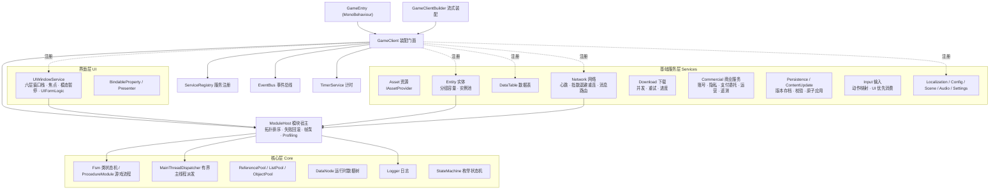

# Lyking 客户端基础框架

Unity 技术栈的商业级游戏客户端框架。分层依赖自上而下单向，核心层零平台依赖——所有纯逻辑子系统都在 `dotnet` 范围内编译、测试与演示，Unity 专属代码集中在 `Unity/` 由编辑器编译。组件模型参考 GameFramework（Ellan Jiang 系）与 TEngine 的成熟设计，并针对本仓库的 headless 验证工作流裁剪。

| | |
|---|---|
| 构建 | `dotnet build Client/GameFramework/Lyking.ClientFramework.slnx`（0 警告 0 错误） |
| 测试 | `dotnet test Client/GameFramework/Tests/Lyking.GameFramework.Client.Tests.csproj` |
| 演示 | `dotnet run --project Client/GameFramework/Demo/Lyking.GameFramework.Client.Demo.csproj` |
| 档位 | netstandard2.1 / C# 9（Unity 2021+ 兼容）；测试与演示 net10.0 |

## 架构总览



依赖规则：**上层可以使用下层，下层禁止感知上层**。`Core` 与 `UI`、`Services` 不引用 UnityEngine（同名 `.asmdef` 供 Unity 编译同一批源码）；`Unity/` 目录只在编辑器编译，dotnet 构建范围排除。

## 子系统目录

| 子系统 | 位置 | 一句话 |
|---|---|---|
| 装配门面 | `Core/GameClient.cs` · `GameClientBuilder` | `Create().WithSink(...).WithModulesFrom(...).Build()` 一条链装配完成 |
| 模块宿主 | `Core/Modules/` | 生命周期拓扑排序、失败逆序回滚、帧回调异常隔离、按模块耗时统计 |
| 游戏流程 | `Core/Procedures/` · `Core/Fsms/` | Splash→更新→主城 的"状态即类"流程机，可并存多个具名状态机 |
| 事件总线 | `Core/Events/` | 类型化发布订阅，处理器异常隔离上报 |
| 服务注册 | `Core/ServiceLocation/` | 实例登记查找，支持具名多实例 |
| 引用池 | `Core/Pooling/` | `IReference` 通用租借 + 重复归还检测；`ListPool`；`ObjectPool` |
| 数据结点 | `Core/DataNode/` | `"A.B.C"` 路径寻址的运行时数据树 |
| 计时调度 | `Core/Scheduling/` | 帧时间驱动的一次性/重复定时器 |
| 窗口 UI | `UI/Windows/` | 六层栈、唯一/独占/模态、全局唯一焦点；`UIFormLogic` 业务基类 |
| 数据绑定 | `UI/Binding/` · `UI/Mvp/` | `BindableProperty`（支持 `Bind` 立即回调）、Presenter 基类 |
| 资源 | `Services/Assets/` | 引用计数句柄；模拟实现可测，Unity 侧接 Resources/Addressables |
| 网络 | `Services/Network/` | 传输抽象 + 编解码扩展点 + 心跳保活 + 异常断开指数退避重连 |
| 数据表 | `Services/DataTable/` | 文本表格加载（制表符/CSV），严格/宽松双模式 |
| 实体 | `Services/Entity/` | 分组容量管理、最旧未固定自动回收、按 key 实例池 |
| 下载 | `Services/Download/` | 队列 + 并发上限 + 自动重试 + 进度事件，代理可换真实 IO |
| 平台与商业服务 | `Services/Commercial/` | 账号/游戏平台、隐私同意、支付验证委托、广告、通知/深链/归因、远程配置及遥测诊断；平台实现必须显式替换模拟类 |
| 输入 | `Services/Input/` | 设备无关动作映射和上下文；UI 消费输入后不再派发玩法动作 |
| 存档 | `Services/Persistence/` | 版本化信封、显式迁移、保护器扩展、暂存校验后原子替换 |
| 内容更新 | `Services/ContentUpdate/` | 清单签名/防回放、块哈希、暂存与原子激活；失败保留旧版本 |
| 本地化等 | `Services/` 其余 | 本地化（回退链）、配置、场景、音频、设置（模拟实现） |

## 五分钟上手

```csharp
// 1) 写一个业务模块：名字、优先级、依赖都写在特性里
[GameModule("商店", priority: 50, Dependencies = new[] { "GamePlay" })]
public sealed class ShopModule : ClientModule
{
    public override ValueTask InitializeAsync(ModuleEnvironment environment, CancellationToken ct)
    {
        // 环境已由宿主预注入，Log / Resolve 可直接使用
        Log.Info("商店模块初始化");
        return default;
    }

    public override void Update(double deltaTime) { /* 每帧逻辑 */ }
}

// 2) 一条链装配客户端
var client = GameClientBuilder.Create()
    .WithSink(new UnityLogSink())
    .WithModule<TimerService>()                        // 内置服务显式登记可控制排序
    .WithModulesFrom(typeof(ShopModule).Assembly)      // 扫描 [GameModule] 批量注册
    .ConfigureServices(s => s.Register<IAssetProvider>(new ResourcesAssetProvider()))
    .Build();

await client.StartAsync();

// 3) Unity 帧循环驱动（GameEntry 已封装）
client.Update(Time.deltaTime);

// 4) 退出
await client.ShutdownAsync();
```

打开一个带模态的窗口：

```csharp
var ui = client.Services.Resolve<UIWindowService>();
ui.Open(new UIWindowDescriptor("确认框", UILayer.Popup, modal: true),
        new ConfirmForm(), userData: "删除存档?");

public sealed class ConfirmForm : UIFormLogic
{
    protected override void OnOpen(object? userData) { /* userData 即打开上下文 */ }
    protected override void OnPause(bool paused) { /* 被更高层模态压制时回调 */ }
}
```

游戏主流程：

```csharp
[GameModule("Flow", priority: -800)]
public sealed class FlowModule : ClientModule
{
    public override ValueTask InitializeAsync(ModuleEnvironment environment, CancellationToken ct)
    {
        Resolve<ProcedureModule>()               // 或由 Builder 登记
            .AddProcedure(new SplashProcedure())
            .AddProcedure(new UpdateVersionProcedure())
            .AddProcedure(new MainCityProcedure())
            .SetInitial<SplashProcedure>();
        return default;
    }
}
// 流程内部：protected void ChangeState<T>() 在 OnUpdate 里自主切换
```

## 语义约定（写代码前必读）

- **生命周期**：`InitializeAsync → Start → Update/FixedUpdate/LateUpdate → ShutdownAsync`。初始化按依赖拓扑序（Priority 小者先，同优先级按注册序），关闭严格逆序。
- **失败语义**：初始化失败 → 逆序回滚已初始化模块并抛 `ModuleStartupException`；帧回调失败 → 单模块隔离（`FrameFaulted`），帧循环继续；关闭失败 → 全部模块都尝试关闭后聚合抛 `ModuleShutdownException`。
- **异常上报优先级**：事件总线/实体/下载等子系统优先隔离上报（事件或日志），无人接盘才抛出——保证一帧的局部故障不放大为整帧中断。
- **线程模型**：框架可变状态由客户端帧线程持有；后台 IO 的结果通过有界 `IMainThreadDispatcher` 返回，必达调用在满载/关闭时明确失败，不能静默丢弃。未被派发器保护的公开类型仍不保证线程安全。
- **模拟实现边界**：`Simulation*`、`Loopback*`、`Memory*` 类型只服务测试与无头演示，不构成真实平台能力声明；生产环境用 `Unity/` 适配层或自行实现对应接口替换。

## Unity 接入

1. 把 `Core/`、`Services/`、`UI/`、`Unity/` 四个目录放入 `Assets/`（或以本地包形式引用），Unity 按四个 `.asmdef` 编译。
2. 场景根物体挂 `GameEntry` 的子类，覆写 `CreateModules()`（或直接使用 Builder）与 `ConfigureServices()`。
3. `GameEntry` 已处理 Awake 装配 → Start 异步启动 → Update/FixedUpdate/LateUpdate 驱动 → OnDestroy 异步关闭的完整链路。
4. Unity 侧代码不在 dotnet 验证范围，接入后需按 `../../CONTEXT.md` 补充编辑模式/运行模式验证。

## 文档导航

- [架构与分层](docs/architecture.md)——依赖规则、失败语义矩阵、扩展点清单、与 Share 框架的关系。
- [模块开发指南](docs/module-guide.md)——从零写一个业务模块：生命周期、UI、实体、流程、网络、计时、数据表的实战写法与常见坑。

## 后续适配边界

| 项 | 说明 |
|---|---|
| 正式网络协议 | 协议契约属 `Share/` 领域；客户端保留 `IMessageCodec` 扩展点 |
| Addressables/AssetBundle 真实加载 | `IAssetProvider` 已留位，随 Unity 工程接入 |
| UGUI/TMP 控件绑定 | `BindableProperty` 已留位，Unity 侧写适配即可 |
| 音频分组混音 | 现有通道模型（Music/Sfx/Voice + 音量）够用，混音器分组随 Unity 接入 |
| 平台供应商实现 | 本框架只含平台中立合同和显式模拟适配；商店、账号、广告、推送、遥测与崩溃 SDK 由项目按目标平台接入 |
| 服务端权威校验 | 客户端不授予支付权益，不把本地存档或本地内容序号当服务端权威；需由游戏服务端实施账号、交易及最低版本校验 |
